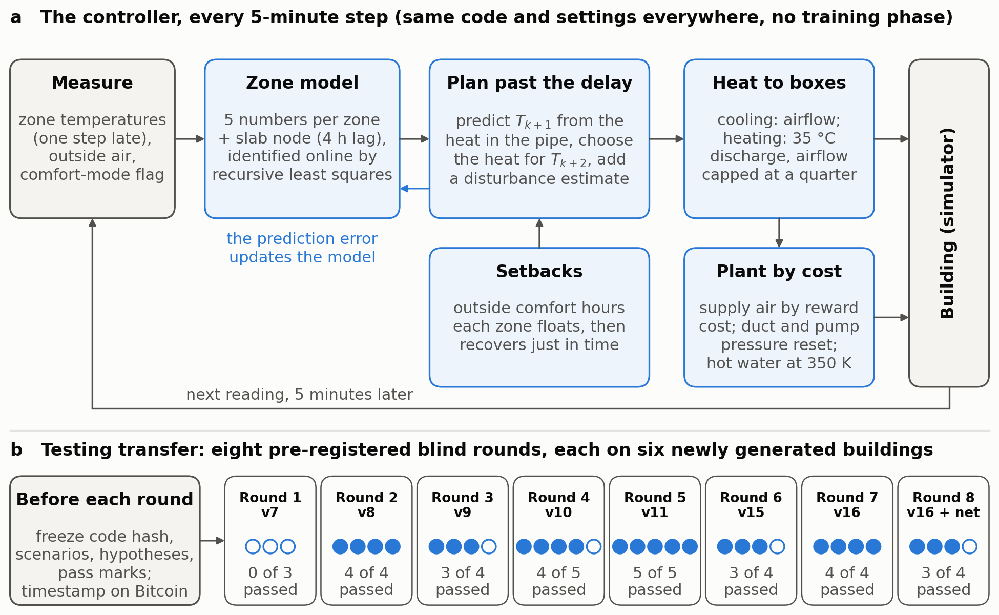
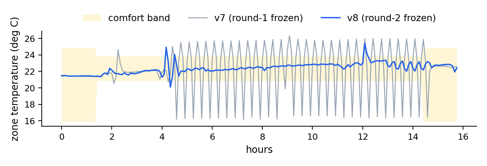

# Zonal: a training-free HVAC controller tested in eight pre-registered blind rounds

Code, plans and timestamp proofs for our paper in the [NeurIPS 2026 Smart Buildings Challenge](https://www.kaggle.com/competitions/neurips-2026-smart-buildings) (paper track, round one). Paper: [PDF](paper/main.pdf) (submitted on OpenReview, submission 38; not public yet).

**In short.** The challenge asks for HVAC control that works in buildings it has never seen. Zonal has no training: it learns a small model of each zone online while the building runs, and plans around the delays it measured. It was tested in eight blind rounds on buildings it had never seen; each round's plan and pass marks were fixed and timestamped in a Bitcoin block (OpenTimestamps) before the results, and the failed rounds are reported too.

- Below the official `pid_water` baseline in all 122 scenarios outside development; public score 0.01031 against 0.06404.
- Without online learning the loss is 2.68 times higher on twelve unseen full-size buildings (1.50 times on the hidden public windows).
- A neural policy trained with PPO for 38 hours reached 0.89 times `pid_water`'s loss on the same buildings; Zonal reached a fifth of the trained policy's.



## Quick start

With the official [starter kit](https://github.com/smart-buildings-2026/starter-kit) installed (`uv sync`), run the final version (v16) on one training scenario:

```bash
python -m sb.run --policy frozen/zonal_v16f.py:TransferPolicy     --kwargs "$(cat submission/V16_PARAMS.json)"     --scenarios <starter-kit>/smart_buildings/training_scenarios     --only building_train_1__atlanta_2 --out results/v16_demo --steps 8640 --workers 1
```

A 30-day scenario takes 12 to 30 minutes on one core. The Kaggle notebook of the same version is `submission/zonal_v16_submission.ipynb`.

## How it works

**Idea: measure, then control.** An open-loop probe of the simulator ([sb/probe.py](sb/probe.py)) showed that heat commanded at one step shows up in a zone's measured temperature one step later, that the room air relaxes within about three steps (15 minutes), and that the floor slab lags the air by about four hours. The controller is built on these facts. Each zone gets a small two-node model (room air and slab), five numbers learned online by recursive least squares while the building runs; the controller first predicts where the zone will be from the heat already in the pipe, then picks the next heat so that the zone lands on its target. A per-zone disturbance estimate removes steady offsets (offset-free MPC). The plant setpoints follow standard VAV sequences: supply-air temperature chosen by estimated cost, static-pressure and pump-pressure reset, and setbacks that let each zone float only as far as its own model can bring it back in time. The hot-water supply temperature is held at 350 K, so the scores do not depend on an accounting issue in the simulator's tank model. No training, no per-building tuning.

## Eight blind rounds

Development used the 30 shipped training scenarios and buildings generated for development, never a blind round's buildings before its run. Every version that mattered was tested once, on buildings made with the official generator from seeds no run had used. Before any run, the frozen code (by hash), the scenarios, the hypotheses and their numeric pass marks were committed to this repository and sent to OpenTimestamps, which anchors them in a Bitcoin block (in rounds 1, 3 and 7 the block came before the first result, in rounds 2, 4, 5, 6 and 8 3-18 minutes after the first few results; `docs/PREREGISTRATION*.md`, frozen copies and `.ots` proofs in `docs/preregistration*/`, blocks and their check in [docs/TIMESTAMPS.md](docs/TIMESTAMPS.md); the controller code each round froze is listed in [frozen/README.md](frozen/README.md)). Every hypothesis is reported as passed or failed; deviations are in [docs/DEVIATIONS.md](docs/DEVIATIONS.md).

| round | frozen version | test set | hypotheses passed | headline |
|---|---|---|---|---|
| 1 | v7 | 6 new buildings, 12 unseen weather windows | 0 of 3 | 7.7 % below `pid_water` (mark 30 %); 30-day runs exposed zone limit cycles |
| 2 | v8 (delay-aware safety net, disturbance estimate) | 6 new buildings, 12 windows | 4 of 4 | 66.7 % below v7, 76.8 % below `pid_water`, better than every baseline in every scenario |
| 3 | v9 (heating-season glide-path setback) | 6 new buildings, 6 cold + 6 warm | 3 of 4 | cold −9.1 % vs v8; comfort hypothesis failed (+7 % regret) |
| 4 | v10 (CMA-ES re-tune of 14 parameters) | 6 new buildings, 6 warm + 6 cold | 4 of 5 | warm −19.7 %, cold +0.2 % (failed: the re-tune did not carry over) |
| 5 | v11 (slab node, pump-pressure reset, cooling setback) | 6 new buildings, 12 windows | 5 of 5 | 27.8 % below v10, 85.0 % below `pid_water`, better in 12 of 12 |
| 6 | v15 (empty holidays, below) | 6 new buildings at full size, ten-day holiday windows | 3 of 4 | 2.67 % below v14, better in 6 of 6; comfort hypothesis counted failed (deviation 6) |
| 7 | v16 (no cooling right after heating, smaller heating margin) | 6 new buildings at full size, cold ten-day windows | 4 of 4 | 7.64 % below v15, better in 6 of 6 |
| 8 | candidate: v16 + delay-aware heating net | 6 new buildings at full size, ten-day windows | main hypothesis failed | −0.12 % against a −0.3 % mark; no v17, v16 is final |

Results: [docs/RESULTS_HELDOUT.md](docs/RESULTS_HELDOUT.md) (round 1), [docs/RESULTS_ROUND2.md](docs/RESULTS_ROUND2.md) to [docs/RESULTS_ROUND8.md](docs/RESULTS_ROUND8.md); paired statistics in [docs/RESULTS_STATS.md](docs/RESULTS_STATS.md) ([sb/stats.py](sb/stats.py)).



## Scores

Mean loss per step (lower is better), as on the leaderboard.

| | training (30 shipped scenarios, 30 days each) | public leaderboard |
|---|---|---|
| `pid_water` (official baseline) | 0.05414 | 0.06404 |
| v8 | 0.01252 | 0.01687 |
| v11 | 0.00744 | 0.01071 |
| v14 | 0.00733 | 0.01048 |
| v15 | 0.00719 | 0.01035 |
| v16 (final) | 0.00716 | 0.01031 |

Over the 122 scenarios outside development (48 in rounds 2-5, 40 in new climates, 34 at full size) the frozen version was below `pid_water` in every one. Most of that gap is comfort (84 %): the comfort term is 3 % of `pid_water`'s, the energy and carbon part 58 % of it ([audit/split.py](audit/split.py)).

What carries the transfer, from ablations of v16 on the twelve full-size buildings of rounds 6 and 7 (rules timestamped before the runs): without online learning the loss is 2.68 times v16's (public score 1.50 times), without the slab node 1.16 times (public 1.78), with all delay handling off 1.14 times (public 1.23) ([docs/TRANSFER_ABLATION.md](docs/TRANSFER_ABLATION.md), [docs/TRANSFER_ABLATION2.md](docs/TRANSFER_ABLATION2.md), [docs/PUBLIC_ABLATION.md](docs/PUBLIC_ABLATION.md), [docs/PUBLIC_ABLATION2.md](docs/PUBLIC_ABLATION2.md)). A neural policy trained with PPO for 38 hours (3.3 million simulator steps) reached 0.89 times `pid_water`'s loss on the same buildings and 5.0 times v16's ([docs/TRAINED_BASELINE.md](docs/TRAINED_BASELINE.md)).

No parameter of v7-v16 (the versions in the paper) was chosen by the public score. Separately, after v16, probes of its settings were submitted to the public board for a second Kaggle selection; they are not part of the paper. Every submission is logged with what we expected and how we read the result ([docs/RESULTS_EXTERNAL.md](docs/RESULTS_EXTERNAL.md)).

## What we learned about the simulator

- **Lag and mass.** One step from heat to measured temperature; a slab about four hours behind the air.
- **Size.** The hidden buildings appear to be full size, while the shipped ones are scaled down; buildings run unscaled, at the size the generator draws, reproduce much of the gap between our training and public scores, through the cooling bill in hot weather and part of the heating in deep cold ([docs/BIG_BUILDINGS.md](docs/BIG_BUILDINGS.md), [docs/HIDLIKE.md](docs/HIDLIKE.md)).
- **Empty holidays.** The occupancy model keeps everybody at home on US federal holidays, but the competition's setpoint schedule lists no holidays and stays in comfort mode, while the comfort term is zero when nobody is in. From v15, a work day on which nobody has come in an hour after the comfort period starts runs as unoccupied; the controller sees only the building's occupant count, not the date ([docs/HOLIDAY.md](docs/HOLIDAY.md)).
- **Tank accounting.** When the hot-water setpoint moves, the gas billed and the heat the coils receive can differ (reported on the competition forum). We hold the setpoint; under the proposed energy-balanced tank our score changes by at most 0.0002 % on the five scenarios checked (starter-kit pull request 2; our copy of the fix is `sb/make_tankfix.py`).
- **Tracker.** The starter kit's occupancy logging changed the returns until a fix on 19 Oct 2026 (starter-kit commit 9567419), and the shipped baseline returns predate the fix (pid_water run directly loses 0.7-3.6 % more on five scenarios). All our runs step the environment directly ([sb/run.py](sb/run.py)).

## Layout

| Path | What |
|---|---|
| `policies/zonal.py` | The controller, with every development option (numpy only) |
| `frozen/` | The exact code each blind round tested, with SHA-256 hashes ([frozen/README.md](frozen/README.md)) |
| `submission/zonal_v*_submission.ipynb`, `submission/V*_PARAMS.json` | The exact code and parameters of each submitted version ([sb/make_notebook.py](sb/make_notebook.py)) |
| `sb/run.py` | Rollouts; steps the environment directly |
| `sb/memsched.py` | Restartable scheduler that keeps at most three simulations within the machine's memory |
| `sb/make_heldout.py`, `sb/make_round6h.py` | Build the blind sets from new seeds |
| `sb/probe.py` | Open-loop identification of the zone response |
| `docs/PREREGISTRATION*.md`, `docs/RESULTS_*.md` | Plans and results of every round |
| `docs/DEVIATIONS.md` | Every departure from a plan |
| `docs/STRESS_TEST.md` | The controller in climates absent from training |
| `paper/` | Paper and figures |
| `analysis/`, other `sb/` scripts | Every analysis and run script used during development |
| `audit/` | Read-only scripts that recompute the paper's numbers from the result files (`recompute.py`, `split.py`) and check its page limit |

## Reproduce

Requires the official [starter kit](https://github.com/smart-buildings-2026/starter-kit) installed (`uv sync`). Simulations are slow (about 0.09 s per step; 12 to 30 minutes per 30-day scenario on one core) and need 1.4 to 2.1 GB of memory per process, more for full-size buildings; out-of-memory crashes in the simulator's sparse solver write no result.

## What this release leaves out

This is a snapshot of the working repository made on 13 November 2026, with the code behind every table and figure in the paper. Left out: private notes, the leaderboard-tuning probes (the paper reports only v16), and one exploratory probe of an accounting issue in the shipped simulator that other teams reported on the forum (cited in one appendix paragraph of the paper; never used for a submission choice). The blind-round building files are not included because they are output of the organisers' generator; `sb/make_heldout.py` and `sb/make_round6h.py` rebuild them from the seeds in each plan, and the manifests in `heldout*/` give their hashes. The raw result files (about 1 GB) that the `audit/` scripts read are not in this snapshot yet. The timestamped plans in `docs/prereg*` and `docs/preregistration*` are stored byte for byte, so their OpenTimestamps proofs (`.ots`) can be checked with any OpenTimestamps client.

## AI assistance

The author used an AI assistant (Claude, Anthropic) to write the code in this repository and to draft the paper's text, then reviewed the paper and verified its results. This is stated in the paper.

## Citation

```bibtex
@misc{cengil2026zonal,
  title  = {Zonal: a training-free HVAC controller tested in eight pre-registered blind rounds},
  author = {Cengil, Abdullah Hamza},
  year   = {2026},
  note   = {NeurIPS 2026 Smart Buildings Challenge, paper track},
  url    = {https://github.com/abdullahcengil/training-free-hvac-sb26}
}
```

## License

Apache 2.0 for the code (see LICENSE). The simulator and training scenarios belong to the competition organisers (see the starter kit).
